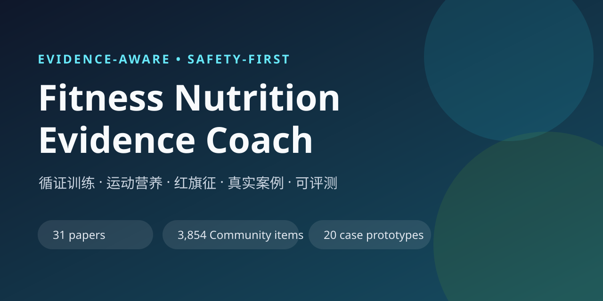

# Fitness Nutrition Evidence Coach

面向中文普通人的循证健身与运动营养 Agent Skill。

它不是动作库，也不是“万能健身提示词”。它把训练、营养、红旗征、证据检索、真实案例、图像分析和盲测评估放进同一套工作流。



## 为什么做这个

普通人的健身问题通常不是“缺一个高级动作”，而是：

- 新手不知道从哪里开始
- 动作疼了，不知道该休息还是调整
- 蛋白质、热量和体重趋势算不清
- 减脂平台期不知道该改什么
- 网络建议互相矛盾，不知道证据强弱
- 私教、补剂和健身房信息过载

本项目用可追溯的证据、明确的安全边界和可执行计划来回答这些问题。

## 特色

- **证据可追溯**：31 篇指南、系统综述、Meta 分析和关键 RCT 的结构化索引
- **真实问题库**：20 类去标识化社区案例，覆盖训练、营养、疼痛、恢复和心理
- **安全优先**：红旗征、专业边界和转介条件写进工作流
- **持续记录**：用户档案、训练日志、营养日志、决策日志和周复盘
- **意图路由**：训练计划、单次训练、平台期、营养目标、补剂、疼痛、图像和测评各有专用流程
- **图像规范**：成人同意、非性化、隐私和“不诊断”边界
- **可评测**：题库校验、盲测评分、回归样例和 Skill 结构验证
- **中文语境**：直接使用中文健身社区的真实问题语言

## 快速开始

### Codex / Claude Code

把 `skills/fitness-coach/` 复制到你的 skills 目录，或直接让 Agent 读取该目录中的 `SKILL.md`。

```text
请使用 skills/fitness-coach 这个 Skill，为一名零基础上班族设计每周三次的训练计划。
```

### 直接试问

```text
我 19 岁，70 kg，体脂约 14%，有一定基础。请给我饮食和训练建议。
```

```text
我深蹲时膝盖疼 5/10，第二天更疼，还能继续练吗？
```

```text
帮我做本周训练和饮食复盘，并只改一个变量。
```

## 例子

- [零基础上班族训练计划](examples/01-beginner-plan.md)
- [膝痛分诊示例](examples/02-knee-pain-triage.md)
- [周复盘示例](examples/03-weekly-review.md)

## 仓库结构

```text
skills/fitness-coach/   Skill 主体
awesome/                100 个 GitHub Skill 参考目录
benchmarks/             验证与评测协议
examples/               可复制的输入输出示例
assets/                 架构图和社交预览
```

## 数据与证据

- `skills/fitness-coach/references/academic-papers.md`：31 篇论文索引
- `skills/fitness-coach/references/community-case-library.md`：20 类真实场景
- `skills/fitness-coach/references/community-problems.md`：社区高频问题地图
- `skills/fitness-coach/references/evidence.md`：ACSM、ISSN、IOC、AASM 等证据基线
- `skills/fitness-coach/references/github-skill-catalog.md`：100 个参考 Skill

## 工具

```bash
python skills/fitness-coach/scripts/validate_question_bank.py \
  --questions questions.json --key key.json

python skills/fitness-coach/scripts/score_blind.py \
  --questions questions.json --key key.json --answers answers.json

python skills/fitness-coach/scripts/search_europepmc.py \
  --query 'resistance training AND older adults' --limit 5
```

## 边界

本项目用于一般健康教育和训练规划，不构成医疗诊断、治疗或临床营养处方。

出现胸痛、晕厥、进行性麻木无力、大小便异常、明显创伤、进食障碍迹象或未控制慢性病时，应优先寻求医生或注册营养师等专业人员。

## 状态

当前版本：`0.6.0`
状态：Alpha / 研究型辅助 Skill。
尚未完成真实用户长期验证、运动科学/营养专家独立审核和商业发布审查。

## 贡献

请先阅读 [CONTRIBUTING.md](CONTRIBUTING.md)、[PRIVACY.md](PRIVACY.md) 和 [DISCLAIMER.md](DISCLAIMER.md)。

## License

MIT。第三方论文、课程、视频、社区内容和商标不包含在本仓库授权范围内。详见 [NOTICE.md](NOTICE.md)。
